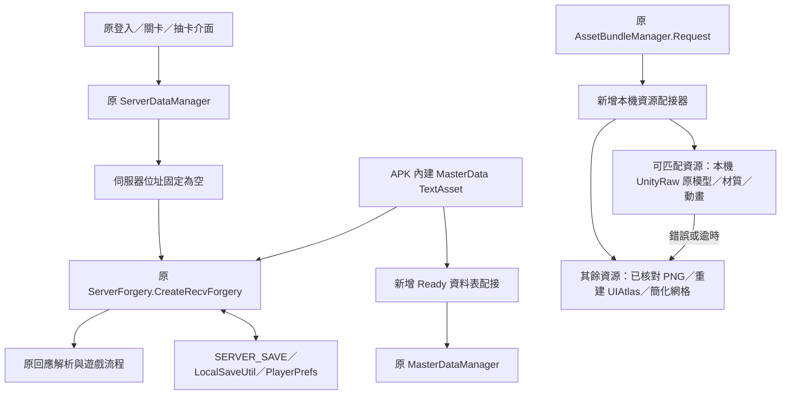

# Divine Gate 離線化實作與其他版本 APK 移植指南

文件核對日期：2026-10-22。實作基準：**1.0.6 offline prototype 21**。

prototype 21 更新：既有 371 筆關卡的備份設定經原 1.0.6 schema 投影後，嵌入配接器並於 `Ready` 開頭套用；原 TextAsset、玩家角色／技能／抽卡資料保留。禁書目錄使用原存檔 ID，28 關後期新增任務未匯入，22 筆需要新版角色的歷史亂入規則停用。既有交付報告記錄舊存檔升級與 364 個 active 任務／706 層生成、本機 API 測試通過；本次提交整理未重跑編譯或完整回歸測試。完整來源、重建命令與限制見 [prototype21 交付報告](artifacts/1.0.6-offline-prototype21-backup-stages/README.md)。prototype 20 章節保留原生模型與動畫的實作背景；目前關卡主資料的有限匯入範圍見第 7.7 節。

本文件供公開查閱及後續移植，說明實際修改、資料與素材的補充位置、已知缺失、建置驗證，以及分析其他 APK 版本的方法。文中原始碼與資料目錄均使用專案相對路徑；APK 內部路徑則保留原有名稱。

2026-10-21 的 [三版比較與 1.0.6 資料移植實驗](offline/comparison/README.md) 補充了跨版欄位、API 與存檔差異：28 張舊表經有限轉換後可在兩版原後端通過部分流程。這是新版承載舊內容的可行性證據，尚未接入新版診斷 APK，不能視為完整內容或 Android 遊玩驗證。

**目前完成的是沿用原客戶端與內建本機 API 的離線原型，並非官方伺服器完整重建。** prototype 20 將備份無損包為本機 UnityRaw，接回 99 區原地圖／門／動畫、98 區效果與 522 個原角色 prefab，缺失或載入失敗才回到既有簡化 fallback。prototype 21 沿用原圖、圖集及原生載入，關卡資料另經舊版欄位與引用相容性檢查後有限匯入。備份年代未確定，不能整批覆蓋舊版主資料；Android 真正載入／渲染與操作待使用者驗證。

## 目錄

1. [基準版本與證據](#1-基準版本與證據)
2. [目錄與維護邊界](#2-目錄與維護邊界)
3. [離線化架構](#3-離線化架構)
4. [實際修改位置](#4-實際修改位置)
5. [API、資料表與存檔](#5-api資料表與存檔)
6. [下載素材的替代載入](#6-下載素材的替代載入)
7. [資料與素材從哪裡補](#7-資料與素材從哪裡補)
8. [已修正問題及原因](#8-已修正問題及原因)
9. [新增及開放的功能](#9-新增及開放的功能)
10. [仍缺失或尚未驗證的部分](#10-仍缺失或尚未驗證的部分)
11. [建置流程與輸入要求](#11-建置流程與輸入要求)
12. [測試範圍與實機驗證](#12-測試範圍與實機驗證)
13. [移植其他版本的工作流程](#13-移植其他版本的工作流程)
14. [給接手 agent 的執行清單](#14-給接手-agent-的執行清單)
15. [版本演進與延伸文件](#15-版本演進與延伸文件)

## 1. 基準版本與證據

| 對象 | 大小（bytes） | SHA-256 |
| --- | ---: | --- |
| 原始 `ディバゲ_1.0.6.apk` | 31,047,374 | `ba3ccd42c28e4d9362cb6bda2b4d21483b98085441f9513ca1b825bc71be81c2` |
| 原始 `ディバゲ_2.1.0.apk` | 32,114,571 | `af40f477e5455caba4f4bbfa24d6fde94e174fc4614db39025c9411be207bb29` |
| 1.0.6 prototype 16 | 184,636,132 | `9b54bdbe1301dc5637dc41e8600444e116a551f1696fd69e1fe9529c24308c88` |
| 1.0.6 prototype 17 | 189,063,908 | `d98b73348e2f17a576f430153e00eec43caecb08422ed53a005435af023bf029` |
| 1.0.6 prototype 18 | 189,133,540 | `2805fe356a0b2701322a3101b94932dcb1ab65a2dcb99521523bf6993861bbff` |
| 1.0.6 prototype 19 | 128,942,820 | `ad49d9b12ee7aa2573f67c0320ad9732f0a272586d5742a46ebfc7c8dac80c3d` |
| 1.0.6 prototype 20 | 175,826,218 | `68a5e639add63b9009a496c4d82612de08af388a67504d3356009c64a27055bc` |
| 1.0.6 prototype 21 | 176,022,826 | `c17afcb856395fb7728075cb6db2215978eac3e48e3f8425589909948d303163` |

最新 1.0.6 APK、建置參數、修改項目與測試結果位於 [prototype 21 產物目錄](artifacts/1.0.6-offline-prototype21-backup-stages/README.md)，其中 `build-report.json`、`backup-stage-import.json`、`backup-stage-tests.txt`、`native-bundle-manifest.json`、`SHA256SUMS`、`signature.txt`、`manifest-summary.txt` 是交付依據。備份來源與日期線索見 [原快取檢查](artifacts/cache-backup-audit-2026-10-22/README.md)。

**2.1.0 已於 2026-10-21 完成獨立移植嘗試，目前交付離線診斷 APK，尚不可遊玩。** 原 APK 保留 `ServerForgery`，但其要求的 37 份 Resources 主資料全部缺失；已從交付 APK 的原本機後端重現創角缺表失敗。版本專用補丁、主資料／素材缺失、建置及驗證見 [2.1.0 報告](offline/v210/README.md)。診斷版通過封裝與 managed 檢查，未進行 Android 安裝與啟動；不能將 1.0.6 的成功推廣為 2.1.0 已可用。

**2.9.0 已另做安全檢查與移植嘗試，目前只有離線診斷原型，無法遊玩。** 該 APK 保留本機 `ServerForgery`，卻沒有其要求的 42 份 Resources 主資料；創角與關卡因此無法從 APK 單獨復原。版本限定補丁、證據範圍、缺失資料／素材及重現方式見 [2.9.0 報告](offline/v290/README.md)。不要將診斷版當成完成的單機版，也不要把 1.0.6 資料直接冒充 2.9.0。

**`sczm/184044_sczm.apk` 已確認為 1.1.0，完成修改前靜態安全檢查與離線診斷原型，仍不可遊玩。** 其本機後端要求的 36 份 Resources 主資料全部缺失；交付 APK 已移除網路、付款、電話與外部儲存權限，並通過靜態／managed 驗證。另以原後端驗證 28 張轉換後的 1.0.6 舊表可通過創角、初始隊伍、登入包與記憶體存檔往返；沒有接入診斷 APK，不能視為 1.1.0 完整內容。詳見 [1.1.0 報告](offline/v110/README.md) 與 [安全證據及限制](offline/v110/SECURITY_REVIEW.md)。

**`sczm/179978_sczm.apk` 已確認為 1.0.9，完成修改前靜態安全檢查與離線診斷 APK，仍不可遊玩。** 原本機後端要求的 34 份主資料全部未內建。另以未修改的原後端驗證 1.0.6 的 28 張舊表可解析、創角、建立初始隊伍及記憶體存檔往返，但登入包會因缺月登入獎勵表失敗；共 6 類所需資料沒有舊表來源。舊資料未嵌入診斷 APK。簽章一致與掃毒未檢出不能保證絕對安全；缺失、驗證與產物見 [1.0.9 報告](offline/v109/README.md) 及 [修改前安全檢查](offline/v109/SECURITY_REVIEW.md)。

原版引擎為 Unity 4.1.0f4，使用舊 Mono 與 APK 中裁剪過的 .NET 程式庫。離線套件名稱為 `jp.gungho.dg.offline106`，顯示名稱為 `Divine Gate Offline 1.0.6`。Android `versionName=1.0.6`、`versionCode=8` 沿用原值；prototype 編號記錄在配接器、畫面及報告中，不是 Android versionCode。

## 2. 目錄與維護邊界

| 位置 | 用途 |
| --- | --- |
| 根目錄原 APK／XAPK | 唯讀來源封存；不能覆寫原檔 |
| [offline/Runtime.cs](offline/Runtime.cs) | 新增離線配接器：啟動、主資料表、資源替代、顯示修正、提示 |
| [offline/Patch.cs](offline/Patch.cs) | Mono.Cecil 對原遊戲 DLL 的版本限定 IL 修改 |
| [offline/FreeChipShop.cs](offline/FreeChipShop.cs) | 免費代幣商品、確認、發放、防重複、存檔 |
| [offline/CollabGacha.cs](offline/CollabGacha.cs) | 四池選擇、原卡片重用、返回清理與動畫還原 |
| [offline/build.py](offline/build.py)、[offline/manifest.py](offline/manifest.py) | 提取、編譯、二進位 Manifest 修改、封裝與簽章 |
| [offline/recovered_images.py](offline/recovered_images.py)、[offline/EmbedImages.cs](offline/EmbedImages.cs) | 圖片核對、圖集產生及舊 Mono 可讀的圖片嵌入 |
| [offline/area_icons.py](offline/area_icons.py) | 保留 Wiki 選關圖，其餘依各區域門景製作 A 構圖裁切與來源對照 |
| [offline/audit_cached_backup.py](offline/audit_cached_backup.py) | 唯讀核對原快取、物件、主資料 schema 及區域／角色覆蓋 |
| [offline/backup_images.py](offline/backup_images.py) | 解碼快取原貼圖，核對原 UIAtlas 座標並優先接入圖片，保留缺圖後備來源 |
| [offline/audit_native_restore.py](offline/audit_native_restore.py) | 唯讀核對原 prefab 階層、UV、材質與門動畫綁定，輸入原快取盤點及 1.0.6 資料表 |
| [offline/native_bundles.py](offline/native_bundles.py) | 將匹配 CAB 無損封裝為 UnityRaw，產生路由索引與雜湊清單 |
| [offline/NativeAssets.cs](offline/NativeAssets.cs) | APK 本機非同步原生載入、共用物件快取、錯誤／逾時降級與資源清理 |
| [offline/backup_stages.py](offline/backup_stages.py)、[offline/BackupStages.cs](offline/BackupStages.cs) | 關卡表投影、既有 ID 保留、資料嵌入與啟動套用 |
| [offline/audit_stage_differences.py](offline/audit_stage_differences.py) | 核對原 APK／交付 APK／備份關卡的欄位及實際遭遇差異 |
| [offline/audit_collab_gacha.py](offline/audit_collab_gacha.py) | 聯動角色、名目權重及本機抽選票號機率盤點 |
| [offline/generate_images.py](offline/generate_images.py) | 缺少素材時的數字／色塊替代圖片 |
| [offline/event_catalog.py](offline/event_catalog.py) | 從原表建立活動／任務清單及關聯檢查 |
| [offline/test.py](offline/test.py)、[offline/tests/](offline/tests/) | 從實際交付 APK 取 DLL 執行的程式與資料檢查 |
| `artifacts/` | 各次 APK、來源清單、下載、調查、測試報告；由 Git 忽略 |
| `external/dgdb/` | 第三方 DGDB checkout，含獨立 Git 歷史；不是本專案 submodule |
| `external/divine-gate-wiki/` | Wiki 媒體及頁面 XML 備份；不是已接入 APK 的完整資源 |
| `external/image-preview.html` | 跨來源素材預覽，圖片未內嵌在 HTML 中 |

`artifacts/` 及大型素材庫不隨原始碼自動發布。公開發行時，應另附可分發的報告與來源清單；未附的相對連結只代表專案中的資料分類，不保證公開下載包包含該檔案。

`offline/` 是本專案維護的新增程式。反編譯得到的原遊戲 C# 只用來理解與定位；**沒有把整個反編譯專案當成正式原始碼重新編譯**。原 APK 中未修改的 DEX、UI、場景與引擎盡量保留。

## 3. 離線化架構

### 3.1 關鍵發現：APK 已保留本機 API 實作

1.0.6 的 `ServerDataManager` 原本就有兩條路徑：

- `LocalSaveManager.LoadFuncServerAddressIP()` 回傳非空字串：走原網路通訊。
- 位址為空且存在 `ServerForgery`：呼叫 `ServerForgery.CreateRecvForgery(...)`，再經原 `ServerDataUtilRecv.RecvPacketAPI(...)` 解析。

因此不是把伺服器域名改成 localhost，也沒有在手機上另開 HTTP 服務。核心做法是回傳空 API 位址、建立 `ServerForgery`，讓原封包流程使用內建本機處理器。

### 3.2 為何只切換 API 還不夠

原客戶端仍會等待更新清單、協議頁、AssetBundle 初始化及商店 SDK，很多角色圖與關卡資源原本也要另外下載。因此需要同時處理啟動門檻、資料表就緒、外部資源回應、原生引擎載入，以及舊 UI 的實際預製物件和生命週期。

「顯示標題」不表示初始化完整；「API 回傳成功」不表示物件、圖集、碰撞及動畫完整。文件後面的修正案例大多源自這個差別。

## 4. 實際修改位置

### 4.1 原 APK 中被改動／新增的檔案

| APK 內部路徑 | 修改內容 |
| --- | --- |
| `assets/bin/Data/Managed/Assembly-CSharp.dll` | 以 Cecil 修改少量方法／呼叫點，加入離線掛鉤與商店存檔存取器 |
| `assets/bin/Data/Managed/DivineGateOffline.dll` | 新增；編譯配接器及生成圖片索引，包含圖片位元資料 |
| `assets/dg-native/*.unity3d` | `--restore-native` 時加入原生素材包；內含原 CAB 位元組及原物件關聯 |
| `assets/bin/Data/mainData` | 在 MonoManager 的 `m_AssemblyNames` 登錄新增 DLL；其他 Unity 物件原始資料逐一核對不變 |
| `AndroidManifest.xml` | 改套件／顯示名稱、移除指定網路與付款權限及服務登錄 |
| `lib/armeabi-v7a/libmono.so` | `--native-direct` 時以 APK 自帶 `assets/libs/armeabi-v7a/libmono.so` 取代舊代理載入器 |
| `lib/armeabi-v7a/libunity.so` | 同上，使用 APK 自帶的真正引擎 |
| `META-INF/` 及 APK 簽章區 | 原簽章失效後重新簽章；不是沿用官方簽章 |

`UnityEngine.dll` 及真正引擎的位元內容不改；原遊戲的 `classes.dex` 沒有重寫。只在測試目錄使用的 `EngineSupport.dll`、測試程式與修改後測試引擎 **不會放進 APK**。

### 4.2 `Patch.cs` 修改原 DLL 的對照表

以下名稱皆以原始 1.0.6 為準，其他版本必須重查簽章與控制流程。

| 原類別／方法 | 改動與配接器入口 |
| --- | --- |
| `LocalSaveManager.LoadFuncServerAddressIP` | 固定回傳空字串，使用原本機路由 |
| `ResidentManager.Start` | 原流程結尾呼叫 `Bootstrap`，必要時 AddComponent 建立 `ServerForgery` |
| `ResidentManager` 新增 `Update` | 呼叫 `PumpNativeAssets` 推進本機載入；未啟用原生素材時直接返回 |
| `ServerForgery.Start` | 原流程結尾呼叫 `Ready`，資料表配接及載入本機存檔 |
| `PatchManager.Start` | 保留 base Start，改呼叫 `SetupPatch`，設定空清單與已取得狀態 |
| `PatchManager.GetPatchText` | 改呼叫 `PatchText`，提供本機版本／更新計數等值 |
| `PatchManager.PatchUpdateRequest` | 停用外部更新請求 |
| `PatchUtil.CheckAppUpdate` | 固定 false，避免要求已關服的應用更新 |
| `TitleMenuSeqInformationFox.Update`、`LayoutSwitchSetting` | 保留基本切頁動畫；透過 `SkipAgreement` 保存本機協議狀態並前進 |
| `TitleMenuSeqLoadAssetBundle.Update`、`LayoutSwitchSetting` | 透過 `LoadLocalAssets` 等待本機表就緒、載入常駐資源、記錄初始化後前進 |
| `AssetBundleManager.Request` | 改呼叫本機 `Request(bundle,name,tag,type)`，回傳原要求的包裝型別 |
| `AssetBundleManager.SetupAssetBundlePackageParam` | 停用原下載套件設定 |
| `AssetBundleManager.ClearAssetBundle` | 原處理前呼叫 `ClearTransientAssets` 清除配接器非駐留持有關係 |
| `UIAtlas.GetSprite` | 原查找前呼叫 `EnsureSprite`，只替離線圖集補正確 Sprite |
| `AssetAutoSetCharaMesh.Update` | 所有 return 前呼叫 `FixCharacterShadow` |
| `BattleManager` 新增 `LateUpdate` | 呼叫 `RaiseEnemyHud`，依選單／對話框狀態切換敵人 HUD 材質 |
| `InGameManager.GetTouchCell` | 前置 `TraceDoorInput` 診斷入口命中；不強制通關／進 Boss |
| `StoreManager.Start`、`Update` | 設定本機停用商店 SDK 狀態，停止付款更新流程 |
| `StoreManager.GetProductFromNum`、`GetProductFromID` | 改為六種免費商品查詢 |
| `MainMenuSeqShopRoot.ProductSetup`、`Update` 的商店開啟條件 | FREE 顯示與本機帳號可用條件，避開零價格折扣除法 |
| `MainMenuManager` 中 `PageShopBuyTip` 資源路徑 | 改成仍內建的 `_old_PageShopBuyTip` 完整確認預製物件 |
| `MainMenuSeqShopBuyTip.PageSwitchSetting`、`Update` | 保留基本切頁處理，改用本機確認／領取流程 |
| `ServerForgery` 新增 `DGOfflineShopPlayer` | 只讀取現有私有存檔物件的公開存取器；連接配接器 `LocalShopPlayer`，不建立第二份存檔 |
| `MainMenuSeqQuestSelectMission.PageSwitchSetting` | 在特定 `m_QuestPlayable` 寫入前套用 `EventQuestPlayable`，只開正式活動難度 |
| `MainMenuSeqGachaRoot.Update` | 聯動請求改由 `RouteGachaRootRequest` 選池；前置正常頁清理／選池專用更新 |
| `MainMenuSeqGachaRoot.PageSwitchSetting` | 原刷新前還原選池外觀，所有 return 前刷新聯動入口與清理 |
| `PlayGameServiceUtil` 的靜態 void 方法、`isSignedIn` | 停用外部登入動作；回報已通過登入狀態以略過不可用入口，不是登入真實帳號 |
| `ResidentManager` 新增 `OnGUI` | 顯示 prototype 編號、離線／替代資源提示及錯誤 |

補丁另加 `DGOfflinePatched` 標記拒絕重複修改；多處用唯一方法、唯一呼叫點、預期 return 數及欄位型別檢查，不符合即失敗。這些限制是防止錯改其他版本的保護，移植時不能只刪掉斷言讓程式繼續。

## 5. API、資料表與存檔

### 5.1 初始化順序

1. 原常駐物件初始化後，`Bootstrap` 建立缺少的 `ServerForgery`。不手動重複呼叫 Unity 的 `Start`。
2. 原 `ServerForgery.Start` 讀取 APK 內建 MasterData。
3. 新 `Ready` 將本機表參照配接到 `MasterDataManager`，並執行 `ConvertMasterSkillLimitBreak`。
4. 清空已過期公告與外部商品表；免費商品由新商店程式提供。
5. 對指定活動／聯動池調整本機可用條件。
6. 呼叫 `UserParamLoad` 載入原本機存檔，後續登入／創角仍使用原封包流程。

兩邊使用共用資料表參照，因此本機條件修改同時供畫面與本機 API 使用；不是把外部 SQL 匯入後覆蓋遊戲資料。

### 5.2 資料來源及關聯

主來源是 **原 APK 的 TextAsset**；啟用 `--backup-stages` 時，僅第 7.7 節的 11 張關卡表在記憶體中改用相容備份資料。`build.py` 用 UnityPy 提取 `MasterData*.json` 供建置與核對。部分舊 JSON 含控制字元，分析腳本使用 `json.loads(..., strict=False)`；遊戲內仍用原 LitJson。

| 資料類別 | 主要原表／用途 |
| --- | --- |
| 帳號與成長 | `MasterDataUserRank`、Login 系列、`MasterDataDefaultParty` |
| 角色 | `MasterDataParamChara`、進化、主動／被動／隊長／限界技能 |
| 關卡 | `MasterDataArea` → `MasterDataQuest` → `MasterDataQuestFloor` → 敵群／敵人及面板組 |
| 場景貼圖 | `MasterDataArea.res_map`；不能只看共用模型 bundle 的名稱 |
| 抽卡 | `MasterDataGacha` → `MasterDataGachaAssign`；保留原權重、等級與加值 |
| 下載定位 | `MasterDataAssetBundlePath`；記錄原請求名稱、分類及包，不代表包內容已存在 |

1.0.6 建置目前硬性檢查角色表 523 筆、任務表 371 筆。角色表包含 fix_id=0 的整合列，實際接圖角色為 522 筆。這些數量及欄位映射都是版本限定，不能直接套在其他版本。

### 5.3 本機 API 的範圍

原 `CreateRecvForgery` 有創角、認證、改名、初始隊伍、登入、好友／助人、隊伍、出售／合成／進化、開始／結算／退休關卡、擴充／回體、抽卡、禮物及部分 debug／轉移等分派。

**有分派不表示每個行為都已完整驗證，也不表示真的連接其他玩家或官方服務。** 好友／助人包含內建產生的資料；原線上帳號、社交網路及官方轉移資料沒有復原。未逐項驗證的 API 應列為待測，不能直接宣稱所有原功能已完整離線。

### 5.4 存檔

原存檔路徑是 `ServerForgerySaveUser` → LitJson → `LocalSaveUtil.SetValueString("SERVER_SAVE", ...)` → `ExecDataSave`／PlayerPrefs。讀取由 `UserParamLoad` 還原同一結構。

新增免費代幣也直接更新這個物件，呼叫原 `UserParamSave`，再同步顯示用 `UserDataAdmin.m_StructPlayer`。存檔失敗時還原記憶體中的免費／總額；沒有額外創建帳戶資料庫。

原型間維持相同套件及測試簽章，可更新安裝保留資料。**其他版本的存檔結構及欄位相容性尚未確認**；建議各版本隔離套件名稱，另行制定存檔轉換與備份流程。`SERVER_SAVE` 同名不代表格式相同。

## 6. 下載素材的替代載入

### 6.1 保留原要求的資源契約

原呼叫者期待 `AssetBundleResource`，裡面有請求名稱、tag、型別、載入狀態與結果物件。新 `Request` 回傳同一型別，正常時為 `LOAD_SUCCESS`，異常時記錄訊息並回 `LOAD_ERROR`。

| 請求特徵 | 配接方式 |
| --- | --- |
| `Atlas...` | 建立離線 `UIAtlas`，指定合成圖片及 Sprite 矩形 |
| `chara_prefab_...` | 建立有 UV、頂點色、透明材質的角色 quad |
| `Texture`／`Texture2D` | 依原資源編號取回角色圖或區域貼圖 |
| `Material` | 以 APK 內建透明 Shader 配接對應圖片 |
| 地圖 mesh／door 類物件 | 建立簡化地板或沒有 Collider 的上層背景平面 |
| 未能配對的圖像／Sprite | 視請求使用數字色塊或 `__missing`；角色跨圖集搜尋必須保留找不到的 null 結果 |

這不是通用 AssetBundle 解碼替代器。其他版本若多出音效、Animator、粒子、骨架等請求，必須新增對應策略，不能一律回傳空 GameObject 並宣稱成功。

### 6.2 圖片準備與封裝

`recovered_images.py` 讀取已核對的來源清單，逐檔比對 SHA-256，再生成：

- `portrait/<resource_id>`：角色透明立繪；原快取模式使用 GPU 貼圖解碼像素，無快取模式保留已核對 web PNG。
- `shadow/<resource_id>`：白色 RGB＋立繪原 Alpha 的遮罩。
- `atlas/AtlasCharaIcon_...`：五組角色圖集；圖示格為 128px。
- `atlas/AtlasPanelIcon`：原快取框為 128px，缺少對應的舊相容框保持 96px；圖集限制在 2048px。
- `atlas/AtlasAreaIcon_000_020`：84 個入口原圖，均為 207×131；名稱沿用原表。無快取模式才回到七張 Wiki 圖與 77 個裁切圖。
- `map/<map_id>/lower`、`upper`：關卡上下貼圖。
- `recovered-images.json`：資源 key、大小、索引、SHA-256、Sprite 矩形、角色映射、來源與限制。

NGUI 使用的像素座標從頂端開始，不能直接套 Unity UV 原點。Alpha 變體圖集共用圖片配接。`backup_images.py` 將原圖集 JSON 與 UIAtlas 序列化座標逐框核對，裁出原尺寸像素再排入新圖集，產生的座標與來源座標分別記錄；不是沿用 web 圖示的推測位置。

舊版裁剪後 `mscorlib` 不保留 `Assembly.GetManifestResourceStream`。因此 `EmbedImages.cs` 將 PNG 嵌入 DLL 的 RVA 欄位，以原遊戲也使用的 `RuntimeHelpers.InitializeArray` 指令按需讀出；不是啟動時把全部圖片建成 Texture2D。prototype 19 APK 為 128,942,820 bytes。

圖片／物件快取在 `ClearTransientAssets` 配合原場景清理釋放非駐留持有關係；不是立刻銷毀仍被場景引用的材質／貼圖。長時間記憶體表現仍需裝置測試。

## 7. 資料與素材從哪裡補

### 7.1 來源、用途與是否已接入

| 來源 | 專案資料位置／證據 | 已接入情況 |
| --- | --- | --- |
| 原 1.0.6 APK | 由原 APK 提取的 MasterData、Unity Data 及原生程式庫 | 原資料、UI、場景、引擎為主要基礎 |
| [kennyfong19931/dgdb](https://github.com/kennyfong19931/dgdb) | `artifacts/web-asset-search-2026-10-20/` 的固定 commit 清單與圖片 | 目前大部分恢復圖片的實際來源 |
| DGDB 完整 checkout | `external/dgdb/`；commit `1a15adf733bb02467d51303a110f361535a7b4bc` | 供查閱，不會自動取代建置清單 |
| [Divine Gate Wiki](https://divine-gate.fandom.com/) 七個城鎮圖片 | `artifacts/fandom-area-search-2026-10-20/`、`fandom-area-images.json` | `area_icon_0001..0007` 保留原 PNG，不以門景裁切取代 |
| Wiki 完整媒體與頁面備份 | `external/divine-gate-wiki/` | 已保存，尚未整批接入 APK |
| 原 CDN 的 Wayback 部分 bundle | `artifacts/cdn-investigation-2026-10-20/recovered/` | 已調查與保存，沒有作為 prototype 16 全部角色／地圖的載入來源 |
| 圖鑑 XAPK | 根目錄及 `artifacts/encyclopedia-audit/` | 來源與覆蓋調查；目前建置不直接載入其 OBB／程式 |

### 7.2 DGDB 命名對照

DGDB 圖片依 `draw_id` 命名，原客戶端資源請求依 `res_chara_id_str`；不能直接把角色 fix_id 當成圖片檔名。

| 角色例子 | 舊 fix_id／素材編號 | draw_id | DGDB 立繪路徑 |
| --- | ---: | ---: | --- |
| クリスティーナ | 347 | 227 | `public/img/large/227.png` |
| ナツ | 379 | 303 | `public/img/large/303.png` |
| エレン | 468 | 404 | `public/img/large/404.png` |
| 上条当麻 | 577 | 515 | `public/img/large/515.png` |

實際接圖由原表的 resource／draw 欄位建立映射，並以 `character-map-106.csv` 與 SQL 唯讀對照留證。DGDB 後期 SQL 只用來核對，沒有匯入為 1.0.6 主資料。Git blob 相同只證明與玩家備份相同，並不證明與原 CDN 內容逐位元相同。

建置輸入清單是 `dgdb-downloaded-assets.json`、可選的 `dgdb-additional-assets.json`、`fandom-area-images.json` 及 `dgdb-commit.json`；每筆 `local_path` 記錄專案相對位置。實際圖片分類保存在 `artifacts/web-asset-search-2026-10-20/recovered-dgdb/public/img/` 等目錄。

prototype 18 另要求 `fandom-ui-images.json`：目前登錄使用者指定的 Wiki `Empty-icon.png`（82×82），作為 `chara_icon_empty` 的覆蓋來源，原 PNG 副本位於 `fandom-ui/Empty-icon.png`。其 SHA-256 與 Wiki 備份的官方上傳 SHA-1／大小均已核對；五個角色圖集及其他含 Empty 的圖集使用新圖並保留 alpha，舊 DGDB 面板來源的同名 Empty 被排除，避免再次覆蓋。測試依 `source_manifest` 核對 Wiki 備份清單，再逐像素驗證七個圖集。原進化頁三個材料空格要求的名稱為 `lock1`，目前在 Wiki 媒體名稱、DGDB 圖片及已檢查原 APK 中未找到獨立原圖；搜尋證據與限制見 [本次交付說明](artifacts/1.0.6-offline-prototype18-wiki-empty/README.md)。

### 7.3 地圖與別名

原表需要 **83 種 `res_map`**，但共用模型包只有 27 種。最新版封裝 86 組上下圖：83 組所需貼圖＋先前依包名保存的額外 3 組。不能以共用模型編號推算目前區域應顯示的門景。

prototype 17 經使用者確認，另外把缺少的選關圖以各區域 `res_map` 的上層門景裁切替代：座標 `(348,108,675,315)`、來源 1024×315、輸出 207×131、Lanczos 縮放。`area_icons.py` 依 `res_map_icon` 分組並檢查共用名稱是否指向同一地圖；76 張門景產生 77 個缺圖 Sprite，七張 Wiki 圖優先保留，合計涵蓋 101 筆有效區域。單圖、裁切座標、來源雜湊與對應關卡記錄於產物 `area-icons/`、`area-icon-manifest.json`。這是明示的替代方案，不是原選關美術復原。

| 原請求名稱 | 備份圖片／來源名 | 限制 |
| --- | --- | --- |
| `map_0006_tex` | `map_0006_tex_lower.png`、`map_0006_tex_upper.png` | 分拆圖，不是原整張材質／原門模型 |
| 魔法禁書目錄 `map_5005_tex` | `map_5005_tex_lower.png`、`map_5005_tex_upper.png` | 同上 |
| `trap_teleport` | `trap_telepot` | 原備份拼字差異 |
| `toaru_key` | `toaru_Key` | 大小寫差異 |
| `panel_alarm` | `trap_siren` | 相容用途圖片，未證明原 1.0.6 像素完全一致 |
| `panel_banana` | `trap_banana` | 同上 |
| `toaru_box_01` | `toaru_box` | 同上 |
| `panel_b_1..6`、`panel_r_1..6`、`panel_y_1..6` | `panel_1..6` | 三組共用黃色星星數量圖，沒有猜測重繪風險顏色 |

固定別名在 [offline/dgdb-sprite-aliases.json](offline/dgdb-sprite-aliases.json)；18 個星星別名由 `recovered_images.py` 生成。別名總共 23 筆。

### 7.4 CDN、圖鑑與 Wiki 備份的意義

2026-10-20 的檢查中，APK 指定 CloudFront 網域無法解析，`gungho-pqdm` 與更新清單的 S3 桶回覆 `NoSuchBucket`。這是當日觀測，並非宣稱所有私人副本不存在；精確 URL 與回應在 [CDN 調查](offline/CDN_FINDINGS.md)。

Wayback 取回兩包 UnityWeb：1.1.0 路徑的 `Unit_000_009.unity3d`，以及 2.1.0 路徑的 `Unit_0973.unity3d`。合計 10 張圖片及角色 prefab／Mesh／材質，沒有完整 1.0.6 地圖集。解析舊版本字串 `4.1.0f4\n1` 時只在解析器記憶體取首行，原下載檔未改。

圖鑑 XAPK 使用 Unity 2018.2.1f1，其 2,060 張角色立繪／圖示對舊版覆蓋 399/522；其餘 123 筆後來由 DGDB 補圖。圖鑑不是舊遊戲地圖模型來源；不能直接把新版 UnityFS 包塞給 Unity 4.1。若後續取用，以資料形式匯出圖片，不必匯入其 DEX、SO、廣告 SDK 或執行圖鑑。

後來 Wiki 備份保存 7,354 筆媒體項目、7,295 個去重檔案及 13,672 頁最新 XML。6,493 筆與 API 原檔雜湊／大小相符；861 筆明確標為 CDN 版本，總數含三張 YouTube 縮圖而非影片本體。這些數字是備份清單統計，**不是 APK 新增素材數**。原檔名保存在 `metadata/image-manifest.json`，媒體依實際 SHA-1 命名；請經 manifest 查找，不要猜 images 目錄的檔名。

圖片預覽用 `external/image-preview.html` 或 Wiki 的 `catalog.html`。來源描述／授權見保存的 File 頁與 metadata，不能把全部遊戲圖片一概當成同一種開源授權。

### 7.5 原 UnityCache 備份（prototype 19）

`jp.gungho.dg/` 有 100 個可解析的 Unity 4.1.0f4 CAB，共 791 個 Texture2D、738 個 Mesh、120 個 AnimationClip。最新建置選用 612 個原貼圖物件（522 立繪、84 地圖、6 原圖集），全部圖集框保留原尺寸像素，再加共用 UI 及未匹配的 web 相容圖。84 張選關原圖取代先前全部 Wiki／門景裁切圖；Empty、`lock1`、18 個風險星數面板與 4 個 heal 原面板已接入。`map_6001`／`6002` 無備份貼圖，保留 web 素材。

CAB 快取索引時間落在 2014-03-27 至 03-31，上層索引另有 2014 年 8 月時間值；不能據此確定備份日期或 APK 版本。備份主表列數與 1.0.6 不同，且 `AssetBundleMasterData` schema hash 不同；prototype 19 沒有匯入主資料、模型或動畫。prototype 20 另接回原模型及動畫（見下節），仍不匯入備份主資料。原始檔雜湊、原物件／矩形、每張圖實際來源與剩餘限制見 [檢查](artifacts/cache-backup-audit-2026-10-22/README.md) 及 [導入紀錄](artifacts/1.0.6-offline-prototype19-native-cache/backup-image-import.json)。

### 7.6 原生模型、動畫與降級（prototype 20）

`native_bundles.py` 將 82 個相關角色／地圖 CAB 原封不動放入 UnityRaw v3 容器，以 `assets/dg-native/` 加入 APK；沒有把 SerializedFile 直接假裝完整 AssetBundle，也不改寫原物件。原依賴只有引擎預設資源，AnimationArray／AnimationEvent schema 與 1.0.6 相符；備份主資料、圖集及不相關包不進入原生載入路徑。

`NativeAssets.cs` 透過原引擎保留的 WWW／AssetBundle.Load API 讀 APK 本機 jar URL，ResidentManager 新增的 Update 負責每幀推進、最多兩包並行。請求在完成前保持 LOADING，正常完成後保留原共用物件；`mapMaterial` 依模型包而非全域同名圖找出。原 `SceneModeGameMain` 會將該區完整 `res_map` 指派給原材質。原 `InGameManager.DoorOpen` 與樓層動畫控制程式均未改動。

可匹配原資料的 99 區與 522 角色使用原 prefab；原生角色帶識別元件，其陰影不再套用矩形專用 alpha 修補，恢復原輪廓／Opaque 深度契約。缺失的萬聖節／聖誕節兩區、`ef_stage_0012`，以及原生包讀取錯誤／30 秒逾時等狀況，改用原 `FallbackRequest`；同一快取週期內不無限重試。清理時 Unload(false)，不丟棄未完成請求。這些載入狀態及原始資料完整性已通過自動測試，仍未驗證真正的 Android WWW 解包／GPU／動畫／觸控。

完整原因、缺失、測試界線與重建命令見 [交付報告](artifacts/1.0.6-offline-prototype20-native-models/README.md)，靜態模型／動畫綁定證據見 [實作前核對](artifacts/native-model-audit-2026-10-22/README.md)。

### 7.7 備份關卡設定（prototype 21）

`backup_stages.py` 僅將原 371 筆任務對應到備份設定，再投影成 1.0.6 欄位。禁書目錄的備份 ID 436～440 對回原 ID 420～424；樓層保留原 ID 及陣列順序，既有通關旗標與存檔欄位不改寫。匯入前會檢查敵群連鎖、角色／掉落與面板引用；需要新版角色或非零新版行動欄位的普通遭遇會拒絕建置，22 筆不相容歷史亂入規則則停用。28 筆後期新增任務不在匯入範圍。

範圍為 `MasterDataArea`、`MasterDataQuest`、`MasterDataQuestFloor`、`MasterDataCategoryPattern`、`MasterDataExpectPattern`、`MasterDataParamPanel`、`MasterDataParamPanelGroup`、`MasterDataEnemyChara`、`MasterDataEnemyGroup`、`MasterDataAreaAmend`、`MasterDataGuerrillaBoss`。角色、技能、抽卡、經濟與全域活動表仍用原 APK；區域加成及相容亂入保留備份歷史日期，沒有強制常駐。

生成的 `BackupStageData.cs` 將 JSON 嵌入配接器，`BackupStages.cs` 在 `Ready` 開頭先解析完整 11 表，再交給原本機 API 與選單共用；解析失敗保留原表。原 TextAsset 不改寫。產物 `stage-tables/` 與 `backup-stage-import.json` 保存實際資料、雜湊、ID 映射及略過項目；進行中的舊地圖快照須重新進入關卡才完整採用新遭遇。

建置需明確加 `--backup-stages --backup-assets` 並提供素材資料集。轉換工具及關卡差異盤點還會讀取 `artifacts/cache-backup-audit-2026-10-22/objects.json`；這份清單由 `audit_cached_backup.py` 產生，不隨 Git 提供，執行前須準備相符備份及盤點。路徑目前固定於程式，跨配置使用前需核對。

### 7.8 關卡與聯動機率盤點工具

`audit_stage_differences.py` 以 `--original-apk`、`--current-apk`、`--backup`、`--output` 比較欄位及有效遭遇，區分固定敵群數量、隨機候選、Boss 連戰與新增行動。若交付版有關卡覆蓋，還須保留同目錄的 `build-report.json` 及 `stage-tables/`，工具會核對 APK 雜湊與配接器內的 JSON。輸出包含 `source-proof.json`、逐關差異、Boss 流程與測試樣本。

`audit_collab_gacha.py` 使用同組 APK／備份參數，另以 `--stage-proof` 指向上述 `source-proof.json`，輸出四個聯動池的角色、加值變體、權重及逐票號結果。原本機抽選的 `<= 0` 邊界使第一列多一個票號、最後一列少一個；報告保留此差異，不修改抽卡程式或權重。備份未找到抽卡表，這些結果不能作為歷史官方伺服器機率。

`VerifyStageAudit.cs` 與 `PrepareGachaAuditProbe.cs`／`VerifyCollabOdds.cs` 是獨立盤點用測試入口，未自動接入 `test.py`；後者僅在拋棄式 DLL 副本供給固定票號並替換存檔／領卡 I/O。來源 APK、真實玩家存檔及正式抽選程式不因盤點而改寫。

## 8. 已修正問題及原因

| 症狀 | 確認原因／限制 | 現行處理 |
| --- | --- | --- |
| 舊 APK 原生引擎載入失敗 | 舊代理載入方式存在相容性問題 | `--native-direct` 使用 APK 自帶真正引擎；不表示支援所有新 Android |
| 教學無法進 Boss 房 | 替代地板使用 primitive cube，預設 Collider 擋在原 `GoalCollision` 射線前 | 移除替代地板 Collider，保留原場景入口判定與流程 |
| 中央白色橫條 | 初期替代門的白色幾何露出 | 不再顯示該替代方塊，改用無碰撞的上層貼圖背景 |
| 立繪後方出現有色方形 | 原陰影依原輪廓網格，替代 quad 卻是矩形 | 由立繪 Alpha 生成白色遮罩，使用原透明陰影 Shader；找不到 Shader 則停用陰影 |
| 不同關卡都使用相同背景／門不對 | 以共用模型包選圖，忽略區域 `res_map` | 優先明確貼圖請求，其次查目前區域 `res_map` |
| 上層門景被地板遮住 | 過大的透明地板延伸到上層背景，透明距離排序覆蓋 | 地面寬 5、按 lower 比例計深度，在 z=2.5 停止；upper 從棋盤遠端延伸 |
| Boss 立繪遮血條 | 角色 quad 與 NGUI 透明排序衝突 | 對敵人 HUD 複製專用材質，使用內建 Overlay Shader queue 3001 |
| 血條又蓋過 MENU／對話框 | Overlay 忽略原 NGUI 的模態順序 | 選單開啟首幀、子頁、關閉過渡與對話框時切回原 HUD 材質 |
| 好友未選時是白色格 | 透明 empty 替代圖露出原白底 | 將實際深色 `chara_icon_empty.png` 放進五組角色圖集 |
| 活動格子的敵人頭像仍是缺圖 | `GetSprite` 在第一組錯圖集建立假 Sprite，原跨圖集搜尋提前成功 | 外來／未知角色 Sprite 保持 null，讓原搜尋繼續找真正擁有者 |
| 免費代幣確認頁只有空背景 | 實際 `PageShopBuyTip` 是標題容器，沒有程式期待的完整控制 | 切換到原 APK 仍內建的 `_old_PageShopBuyTip`，驗證訊息及 Yes/No Collider |
| 聯動頁只有標題 | 新容器／克隆的舊 NGUI 顯示註冊未由先前測試驗證；不能單憑截圖鎖定單一原因 | 重用原三卡、只補第四張、沿用父物件與圖層，明確設定 enabled／alpha／CreatePanel |
| 抽完返回後第四張卡殘留 | 原頁 fade-in 遞迴啟用所有子物件與 Collider，選池已關閉所以舊條件不清理 | 正常頁刷新後、Update 輸入前重做第四卡／選池 Back 清理 |
| 選池返回按鈕大小／動畫未還原 | 快照捕捉按壓／懸停中的尺寸，舊 Tween 還能覆寫還原結果 | 快照前、卡片設定後、外觀還原後呼叫 `OnHover(false)`，停止 Tween，起終點歸正常尺寸 |

### 8.1 幾個移植時容易漏掉的細節

- 原 `GoalCollision` 約位於 `(0,-0.3,3)`；新門景只是顯示，沒有建立另一個入口 Collider，更沒有直接呼叫勝利／Boss 切頁。
- `res_map` 與模型包不是一對一：測試有 61 個區域需要的貼圖不同於其模型包名稱。
- HUD 只切換敵人 UI 材質，不修改共享圖集或縮小原 Boss 圖；選單狀態要同時看實際 UI root、狀態機和 Dialog，不能只看一個旗標。
- `UnityUtil.SetObjectEnabledFix` 會遞迴啟用 Behaviour、Renderer、Collider，單次 `SetActive(false)` 不能永久保證不再出現。
- `UIButtonScale` 還有私有快取與懸停狀態。只寫 `transform.localScale` 不能停止舊 `TweenScale`；現行做法保留之後正常按壓／懸停，不每幀強制鎖尺寸。

## 9. 新增及開放的功能

### 9.1 活動常駐

`OpenLocalEvents` 只調整區域：type=2 活動、type=3 進化區域的 `event_id=0`；type=2 的 `pre_area=0`。`EventQuestPlayable` 只放行 type=2 且 `quest.active=2` 的正式活動難度，保留主線順序與 reserve 停用狀態。

目前清單為 49 個活動區域、132 個正式難度、6 個進化神殿，另有 7 筆 reserve。沒有為解鎖偽造通關旗標，也沒有全域開啟歷史商店、倍率與公告。原體力、獎勵與結算仍走本機 API。完整名稱見 [活動清單](artifacts/1.0.6-offline-prototype10-events/EVENTS.md)。

### 9.2 商店六種免費代幣

按原 Android 商品順序，由左至右、上排再下排：**1、6、12、25、52、85 枚**。商品 ID 為 `jp.gungho.dg.chip<數量>`，顯示 `FREE`，經確認後可重複領取。

實作只增加 `have_stone_free`，總額等於免費＋付費；付費餘額及購買歷史不變。總額上限 999，整包超過即拒絕，不截斷也不溢位。同一確認頁只提交一次，取消／外來頁不發放，存檔後同步頂部餘額。這是新增離線福利，不是恢復 Google Play 付款。

### 9.3 四個聯動池選擇

| 選池名稱 | 卡池 ID | 原 event_id | 不重複角色數 | 每抽 |
| --- | ---: | ---: | ---: | ---: |
| FAIRY TAIL | 300100 | 600010 | 7 | 5 枚 |
| 進撃の巨人 | 300200 | 600020 | 6 | 5 枚 |
| ケリ姫スイーツ | 300300 | 600030 | 6 | 5 枚 |
| とある魔術の禁書目録 | 300400 | 800690 | 7 | 5 枚 |

只改這四個池的時段條件；原畫面只有一個聯動槽位，若只是全部 `event_id=0`，後一筆會覆蓋前一筆，因此需要新增四池 UI。

原 `GachaType3` 下的 `Element00/01/02` 在選池時暫時排成四格，第四格由原卡複製。選定後只設 `MainMenuParam.m_GachaID` 及原圖鑑取得旗標參照，不在選池階段扣幣。之後沿用原確認、單抽／最多九連抽、刮卡、背包與存檔程式。友情與普通稀有流程保留；四個選項目前共用原聯動卡圖，以名稱區分。

原 1.0.6 沒有 STEINS;GATE 的 type=3 卡池記錄；有該活動關卡或角色圖片，不等於存在可直接開啟的卡池。權重保留 APK 內建資料，不宣稱歷史官方機率已核實。

### 9.4 IL 呼叫契約

`MainMenuManager.AddSwitchRequest` 原本回傳 bool，原呼叫後有 `pop`。替代的 `RouteGachaRootRequest` 必須也回傳 bool 並補上 page 參數；早期 void 替代版已被測試拒絕，不能使用。原 `MainMenuSeqGachaConfirm`、`MainMenuSeqGachaMain` 方法指令由測試比對維持不變。

## 10. 仍缺失或尚未驗證的部分

### 10.1 圖片清單的「缺」要區分版本

原 [priority-image-filenames.txt](artifacts/missing-image-audit-2026-10-20/priority-image-filenames.txt) 是歷史 112 項需求。prototype 19 共有 **109 項配接、剩餘 3 項**；全部 84 個選關圖與四個 heal 已採用備份原圖或可靠拼字別名。

| 分類 | 數量 | 精確名稱／判定 |
| --- | ---: | --- |
| 尚無可靠對應 | 3 | `mugen_box.png`、`panel_panic.png`、`panel_weekness.png` |

保留原請求拼字 `happytresure`、`weekness`，前者以備份原面板 `heal_happytreasure` 配接。無限迷宮與魔法禁書目錄選關圖已從備份 Area 圖集復原。最新精確名單見 [覆蓋清單](artifacts/1.0.6-offline-prototype19-native-cache/priority-image-coverage.json)。

原清單並非連續整數，例如有 `area_icon_2007_a`、`2007_b`，不能用整數範圍代替實際名稱。歷史版本的 77 個門景裁切只保留於舊產物與無快取建置路徑。

### 10.2 其他缺失與限制

| 項目 | 現況／需要補什麼 |
| --- | --- |
| 原關卡模型、門及房間動畫 | prototype 20 已接入 99 區原資料／載入路徑，Android 動態待測；萬聖節／聖誕節仍無原資料而 fallback |
| 原整張 `map_XXXX_tex` | 原生模型使用原全貼圖；既有分拆圖僅供缺失／載入錯誤時 fallback |
| 原 `IconPackPanel`／`IconPackArea` 圖集 | 原框座標／像素已核對，以新位置重排；18 個顏色星數面板已復原，仍有 3 個精確需求缺圖 |
| 部分效果、粒子、音訊、聯動刮卡專屬美術 | 沒有完整逐項復原／驗證；外部音訊備份沒有整批接入 |
| 官方伺服器資料及帳號 | 沒有恢復歷史帳號、真實好友、線上活動狀態、官方存檔或完整營運規則 |
| 全關卡可玩性 | 132 活動的本機 API 啟動／結算檢查不等於每關已在 Android 實際通關 |
| 長時間記憶體與所有裝置 | 待測；圖片比初期替代版大很多 |
| 新 Android 相容性 | 僅 armeabi-v7a；min SDK 9、target SDK 17；不是 arm64 版 |

原生程式庫靜態分析顯示舊引擎有實際 text relocation。不能只改 target SDK 或把資料夾改成 arm64 就宣稱相容；參考 [Android 16 相容性分析](artifacts/android16-compatibility-audit-2026-10-20/README.md)。該報告不包含 Android 16 裝置測試結果。

## 11. 建置流程與輸入要求

### 11.1 建置依賴與可攜性

實作使用 Python／UnityPy 解析 Unity 資料、Mono C# 編譯器編譯配接器、Mono.Cecil 修改 IL，並使用 Android 封裝工具檢查 Manifest、對齊及簽章。反編譯工具只供理解原程式，不參與整個遊戲原始碼的重建。

現有腳本仍有固定工作目錄及工具定位設定，尚未完成跨配置參數化。移植時應將來源 APK、工作目錄、素材根目錄、工具與簽署設定改為明確參數；不能把既有開發配置當成遊戲離線化的必要條件。本節描述輸入、階段及驗證契約，不綁定特定電腦或執行配置。

原 APK 應保持唯讀，提取／反編譯／編譯中間檔使用獨立工作目錄。維護發行時須保持簽署憑證一致，否則不能直接更新既有安裝；測試簽章不等於官方簽章。簽署私鑰不屬於公開文件或發行素材。

### 11.2 素材輸入前提

建置不是只靠 Git checkout 即可完整重現：原 APK、調查產物及大型第三方素材不隨原始碼自動發布。重現時需自行準備版本相符的 APK、已核對素材及來源 manifests；完整 DGDB checkout 不會自動生成目前全部 manifests。

`recover_dgdb_variants.py` 依已存在的固定 tree、commit、缺圖 audit 及初次下載清單補 118 張地圖變體與 4 張候選圖，**不是從空目錄重建全部調查的下載器**。使用前須備妥其輸入清單，並確認來源版本。

新增素材時須記錄原來源 URL／commit、原檔名、尺寸、格式、雜湊與配對理由，更新來源 manifest，再由 `recovered_images.py` 生成索引；不要直接手改生成的 `RecoveredImages.cs` 或 DLL 中的圖片。

### 11.3 建置入口及階段

入口為 `offline/build.py`，完成後以 `offline/test.py` 讀取該次 `build-report.json` 驗證。參數用途如下：

| 參數 | 用途 |
| --- | --- |
| `--native-direct` | 使用 APK 自帶的真正引擎，替代舊代理載入器 |
| `--recovered-assets` | 指定包含來源 manifests 與已核對素材的資料集 |
| `--backup-assets` | 指定 `jp.gungho.dg` 原快取，優先覆蓋每個匹配圖片；須搭配 web 資料集供缺圖保留 |
| `--restore-native` | 搭配備份路徑，封裝原角色／地圖 prefab 與動畫；啟用本機非同步載入及 missing/error/timeout fallback |
| `--backup-stages` | 搭配備份與既有快取盤點，匯入 11 張相容關卡表；保留原任務／存檔 ID，不加入後期新任務 |
| `--output` | 指定新的產物目錄，不覆寫既有 APK |
| `--work` | 指定獨立的中間檔工作目錄 |

`--recovered-assets` 省略時是數字／色塊素材模式；不能把該建置當成已補圖的交付版。以上參數尚未涵蓋腳本中的全部固定設定，跨配置執行前仍需檢查原始碼。

`build.py` 的步驟：

1. 檢查原 APK SHA-256、ZIP 完整性，拒絕錯版／已有輸出 APK。
2. 提取原 Unity Data 至獨立工作目錄，讀表並檢查數量；選用備份關卡時先投影、驗證及嵌入資料，再依實際生效表產生活動清單。
3. 生成替代圖與核對素材，建圖集、PNG 包、索引及來源報告；啟用 `--restore-native` 時，另核對原 CAB 依賴／元件 schema，無損封裝本機資源包及原生路由索引。
4. `mcs -nostdlib` 對**原 APK 的 mscorlib／System／System.Core／UnityEngine／遊戲 DLL（含 Assembly-CSharp-firstpass）** 編譯配接器。
5. Cecil 嵌入 PNG，執行 `Patch.cs` 修改原遊戲 DLL；封裝前執行聯動掛鉤契約檢查。
6. 在 mainData 的 MonoManager 登錄新 DLL，核對其他物件原始資料沒有改動。
7. 二進位修改 Manifest；依 `--native-direct` 放入自帶真正引擎。
8. 重建 APK、zipalign、測試簽章，驗證 ZIP、簽章、對齊、套件、權限與修改檔案集合。
9. 輸出 APK、SHA256SUMS、Manifest／簽章摘要、圖片報告、build-report；再用 `test.py` 檢查實際封裝 DLL。

## 12. 測試範圍與實機驗證

### 12.1 程式與資料測試

測試先核對 APK hash，再從該 APK 取出原遊戲與配接器 DLL。引擎替身只存在於隔離測試目錄，Resources、PlayerPrefs、部分 Transform／元件／啟用旗標等由替身提供，不修改正式 APK 的引擎。

| 測試檔／組別 | 驗證重點 |
| --- | --- |
| `VerifyReferences.cs` | 新配接器引用能在原裁剪引擎／BCL 找到 |
| `LocalApiTests.cs` | 建帳、改名、初始隊伍、認證、主資料、登入包、教學開始／結算及另一程序重讀 |
| `VerifyEventPatch.cs`、`VerifyEventUnlock.cs` | 只修改預期關卡存取點；132 活動 API 開始／扣體／結算，reserve／主線規則保留 |
| `VerifyFreeChipShop.cs` | 六包數量、免費／付費分離、999 上限、溢位、取消、一次提交、持久保存 |
| `VerifyShopPrefabHook.cs`、`verify_shop_prefab.py` | 真正選到完整 prefab，訊息／Yes／No 控制存在；空容器為反例 |
| `VerifyCollabHooks.cs` | bool 堆疊、原動畫／教學與原確認／刮卡指令保留；快照／還原／正常頁清理掛鉤 |
| `VerifyCollabGacha.cs` | 四池資料／選擇、原權重、每池單抽＋九連抽，共 40 張卡的資格、扣幣及跨程序保存 |
| `VerifyCollabReturn.cs` | 100 次模擬選池／關閉／重新啟用，第四卡、Back Collider 與原三卡隔離 |
| `VerifyCollabAnimation.cs` | 四卡共 100 次原 `UIButtonScale`／`TweenScale.Begin` 狀態循環，重設後仍能按壓／懸停 |
| `verify_collab_prefab.py` | 原卡父節點、178×215 Collider、UILabel／UISprite、沒有搶點擊的子 Collider |
| `VerifyRecoveredImages.cs` | 實際嵌入 1,223 個 PNG payload 的 hash 與 Sprite 矩形 |
| `VerifyRenderFixes.cs`、Alpha 比對 | 透明陰影、HUD 掛鉤、上層景無新增 Collider；522 遮罩 Alpha 與立繪一致 |
| `VerifyEnemyAtlasSearch.cs` | 1,044 次角色／Alpha 圖集搜尋選到真正擁有者 |
| `VerifyHudPopup.cs` | 23 個戰鬥／選單／過渡／對話框狀態 |
| `VerifyMapTextureRouting.cs` 等 | 404 次貼圖路由，包含原 61 個材質與模型編號不同的區域 |
| `verify_backup_images.py` | 232 檔雜湊不變；612 個貼圖、690 個立繪／地圖 payload 與 834 個原圖／共用框像素核對，18 個原色星數與 84 張選關圖 |
| `verify_native_bundles.py`、`VerifyNativeHooks.cs`、`NativeAssetTests.cs` | 實際 APK 82 包／CAB 位元組、原始門流程保留、原生陰影保護、載入成功／錯誤／逾時／缺物件降級與清理；WWW/GPU／fallback 工廠由替身提供 |
| `verify_backup_stages.py`、`VerifyBackupStages.cs` | 交付版 11 張關卡表雜湊／內容與共用參照、prototype 20 隔離存檔升級、364 個 active 任務生成及 API 流程；需備妥前版 APK |

1,223 是封裝 payload 數，包含 522 立繪、522 衍生陰影、172 地圖圖及 7 張合成圖集；不是所有來源小圖的數量。七張合成圖集為五組角色、一組面板、一組城鎮圖。

上述測試**不執行原生 Unity 渲染、真正時間推進、觸控射線、刮卡演出或裝置儲存／載入器**。測試通過只能作為交付前的程式及資料證據，不能替代 Android 安裝與遊玩。

### 12.2 Android 手動測試清單

使用支援該 APK 原生架構的 Android 裝置或模擬器。測試時記錄版本、安裝方式與操作結果，並使用獨立測試資料；更新相容性測試則保留既有資料，避免用清除資料掩蓋問題。

1. 記錄 APK SHA、裝置／模擬器、Android 版本、ABI、安裝與啟動結果。
2. 新帳：開場、命名、初始角色、教學、鑰匙／Boss 入口、結算與重啟。
3. 更新安裝：既有角色、隊伍、餘額及進度保留；不透過清資料掩蓋問題。
4. 畫面：立繪透明、陰影、敵人頭像、空好友格、星星數、不同區域 lower／upper。
5. 戰鬥：Boss 血條、回合／狀態圖示；MENU 首幀、Options／Retire、對話框及關閉過渡。
6. 活動：選區、難度、助人、開始、結算；reserve 不應被當成可玩關卡。
7. 商店：取消／確認、六包、餘額顯示、999 邊界、連點及重啟保存。
8. 聯動：四池名稱與確認池一致、取消不扣幣、單抽／九連、領卡、返回與重啟。
9. UI 循環：選池 Back、其他主選單往返、連續抽卡返回、再次按壓；四卡／三卡、Collider、數量與尺寸都正確。
10. 開啟飛航模式／停網後重啟與遊玩，檢查完整離線流程；長時間切場景觀察記憶體與崩潰日誌。

早期版本的啟動截圖或紀錄不能作為 prototype 16 已實機通過的證明；驗證結果須與實際受測 APK 的 hash 綁定。

## 13. 移植其他版本的工作流程

### 13.1 先作唯讀版本盤點

每個版本應先完成以下唯讀分析，再決定補丁策略：

1. 計算 APK SHA-256，列出封裝內容與 Android Manifest 資訊。
2. 在獨立工作目錄提取 Unity Data、Managed 程式集與原生程式庫，保留原檔。
3. 以相符版本的相依程式集解析 `Assembly-CSharp.dll`，用反編譯器檢查類別及 IL。
4. 若沒有 Managed DLL，確認是否使用 IL2CPP；此 Cecil／Mono 方案不能直接套用。
5. 建立資源、API、資料表及存檔契約清單，與 1.0.6 逐項比較。

反編譯輸出只供分析，仍不直接重建整個原遊戲。2.1.0 的檔案指紋可作為輸入辨識依據，不代表已完成補丁或可直接套用 1.0.6 的腳本。

盤點報告至少包括 Unity／Mono／BCL 版本、ABI、SDK、原生代理與真正引擎位置、資料表及下載包、API／更新 URL、包名、簽章與資源清單。不同版本 CDN 路徑已知會不同，參考原 `CreatePackagePath` 實作，不靠 1.0.6 字串替換猜測。

### 13.2 決定本機後端策略

依序確認：

1. 是否仍有 `ServerForgery` 或相似開發用後端？是否能完整載入自己的資料表？
2. 網路管理器何時改走它？位址為空、編譯條件、旗標或其他邏輯是否不同？
3. 需要的 API enum、Send／Recv 結構、錯誤碼、Header 版本及資料列是否匹配？
4. 創角、登入、隊伍、關卡、抽卡等實際需要哪些端點？逐一檢查 handler 內容，而非只找到名稱。
5. 存檔如何持久化？是否保有 `SERVER_SAVE`、序列化欄位及新版本新增機制？

若本機後端不存在或只剩空殼，就需要另外實作版本對應的封包處理與存檔模型；1.0.6 的工作量不能當成該版本只需幾個 patch 的證據。不要只回「成功」跳過還沒完成的 API，這可能在稍後進入缺欄位／缺物件流程才崩潰。

### 13.3 新增版本設定與補丁，保留 1.0.6

目前硬編碼處包括 `build.py` 的原檔／hash／數量、`manifest.py` 的包名／名稱、`Runtime.cs` 的版本字串與資源規則、`Patch.cs` 的方法／欄位／IL 形狀、活動類型、商品及四池 ID。`recovered_images.py` 也固定使用五組角色圖集、原資料欄位與 1.0.6 bundle 標籤。

建議新增明確版本設定及獨立 patch／測試入口，而不是把現行檢查全部放寬：

| 要重查的契約 | 其他版本需記錄 |
| --- | --- |
| 原檔辨識 | 檔名、SHA-256、Unity／程序集版本 |
| IL 掛鉤 | declaring type、參數、回傳型別、static／instance、分支／return、預期匹配數 |
| 主資料表 | 原 TextAsset 名稱、結構型別、欄位、關聯、筆數與可用範圍 |
| 資源請求 | bundle／name／type／tag 與完整預期物件階層 |
| UI | 實際 Resources 路徑、prefab 控制元件、圖層、深度、碰撞、動畫 |
| 本機存檔 | schema、儲存 key、版本隔離與升級方案 |
| 平台 | 原生 ABI、載入器、SDK、可用 Shader／BCL／Unity API |

例如遇到既有 `BattleManager.LateUpdate`，必須保留原內容並選適當掛鉤，不能直接新增同名方法。`Append`／每個 return 的處理也要注意 branch 直接跳向 return；只在 return 前插入指令，可能被分支跳過。

### 13.4 以該版本自己的表建立素材映射

先從原表產生角色／區域／Sprite／bundle 需求，再對 DGDB、Wiki、圖鑑或舊快取配對：

1. 角色分清 `fix_id`、`draw_id`、`res_chara_id_str`，檢查缺值／重複／編號範圍。
2. 圖集分組不能假定仍每 200 個或只有五組；另查 Alpha 命名與跨圖集搜尋。
3. 區域用 `res_map` 與入口圖示各自配對；若採 prototype 17 經使用者確認的裁切替代，必須明示來源及裁切，不能冒充原選關美術。
4. 保留 Alpha、尺寸、來源與裁切證據；JPG 不可自動當成透明立繪。
5. 只把已確認素材加入輸入清單；相容替代／猜測候選／真正原檔分開標記。
6. 新版 bundle 不保證舊引擎可讀。可先匯出資料重建；真正模型／動畫移植另查格式、Shader 與掛載關係。

初始版本只需先打通啟動、建立帳號、教學與保存。圖片可使用明確替代圖做診斷，再分批接回，避免把 API、渲染及 UI 三類失敗混在一起。

### 13.5 編譯、封裝及驗證

對該版本原裁剪程序集編譯新增 DLL，不使用主機 .NET 的較新 API 當作手機一定具有的能力。新版本可能有不同 MonoManager 登錄、分段檔、Manifest 字串池或原生 SO 配置；`mainData`／manifest 修改器不適用時應明確停止，不直接用 1.0.6 輸出覆蓋。

分段確認：原檔完整性 → 類型與方法契約 → 本機 API → 資料／資源關聯 → prefab／UI → APK 簽章與修改檔集合 → 核准 Android 裝置。必須用**該次真正交付 APK**再取 DLL 測試，避免測到暫存舊版而交付另一版。

移植完成後另寫版本報告：原 SHA、產物 SHA／大小、包名／簽章、改哪些檔、資料來源與缺失、程式測試結果、裝置／Android／ABI 及實機結果。沒有實機證據就維持 pending，不以 1.0.6 截圖充當新版本驗證。

## 14. 給接手 agent 的執行清單

1. 先讀本文件、`offline/README.md` 及目標產物報告，區分歷史調查與現行狀態。
2. 核對原檔 hash、素材 manifest、版本相依工具及簽署要求，確認建置輸入完整。
3. 選定此次目標版本、包名、資料範圍及可驗證的最小流程，產生版本盤點。
4. 先確認本機 API 路由與存檔，再處理資源替代，最後增加商店／活動／卡池等選用功能。
5. 保持版本限定檢查；不得以改輸入 hash、改所有 class 名、刪失敗斷言的方式硬套補丁。
6. 修改 UI 前讀真正 prefab；檢查可見性、Collider、panel 註冊、遞迴重新啟用及 Tween 私有狀態。
7. 新功能沿用同一份本機存檔；取消不提交、確認有防重複，處理邊界及重讀。
8. 新建產物目錄，保留原 APK／舊版；不提交生成二進位、原反編譯檔、裝置資料或金鑰。
9. 按影響範圍執行實際 APK 檢查，記錄資料／資源／UI 測試的限制，另安排實機驗證未測項目。
10. 更新本版本使用說明、未解決項目與來源對照；不要覆寫歷史調查來掩蓋曾經失敗的版本。

## 15. 版本演進與延伸文件

| 階段 | 主要內容 |
| --- | --- |
| prototype 1／native-direct | 打通原內建本機後端、啟動流程、替代素材與舊引擎載入 |
| prototype 2 | 修正替代地板 Collider 擋 Boss 入口，加入入口診斷 |
| prototype 3／r2 | 接入已核對角色／圖示／面板等素材 |
| prototype 4 | 立繪陰影 Alpha 遮罩 |
| prototype 5 | 區域貼圖變體與名稱配接 |
| prototype 6 | 上層背景／門景與敵人 HUD 排序 |
| prototype 7 | 空好友／空角色格修正 |
| prototype 8 | 敵人跨圖集搜尋、地板與門景排序 |
| prototype 9 | 模態 UI 前後景、七個城鎮入口圖 |
| prototype 10 | 活動與進化區域常駐 |
| prototype 11／12 | 免費代幣；修正確認頁選到空 prefab |
| prototype 13 | 四池選擇；其中未修復候選有 DO_NOT_INSTALL 標記，不能使用 |
| prototype 14 | 重用原三卡、只補第四張、原 NGUI 階層與註冊 |
| prototype 15 | 抽卡返回重新啟用造成的第四卡／Collider 殘留 |
| prototype 16 | 快照前及返回後清除按壓／懸停 Tween，還原正常尺寸 |
| prototype 17 | 保留七張 Wiki 圖，其餘 77 個選關圖示以各區域門景裁切替代 |
| prototype 18 | 改用使用者指定的 Wiki Empty-icon.png，排除舊同名來源；記錄 lock1 搜尋範圍與缺失 |
| prototype 19 | 使用者提供 UnityCache；522 個角色、84 選關、84 地圖、原 Panel、Empty／lock1 優先換成備份原圖，主資料／幾何未匯入 |
| prototype 20 | 無損包裝 82 個原生包，接入 99 區模型／門動畫、98 區效果及 522 角色，原生角色不再走矩形陰影修補，缺失／錯誤降級 |

延伸證據：

- [目前使用說明](offline/README.md)、[prototype 20 交付報告](artifacts/1.0.6-offline-prototype20-native-models/README.md)、[備份檢查](artifacts/cache-backup-audit-2026-10-22/README.md)。
- [2.1.0 離線移植嘗試與缺失清單](offline/v210/README.md)、[診斷 APK 驗證](artifacts/2.1.0-offline-diagnostic1-verified/verification.txt)。
- [原 CDN／Wayback 調查](offline/CDN_FINDINGS.md)、[公開網站素材調查](offline/WEB_ASSET_FINDINGS.md)。
- [圖鑑 XAPK 分析](offline/ENCYCLOPEDIA_AUDIT.md)、[原始缺圖核對](offline/MISSING_IMAGES.md)、[DGDB 命名對照](artifacts/dgdb-name-mapping-2026-10-20/README.md)。
- [聯動池資料與原 UI 限制](artifacts/1.0.6-collab-gacha-audit-2026-10-20/README.md)、[活動清單](artifacts/1.0.6-offline-prototype10-events/EVENTS.md)。
- [第三方目錄與圖片預覽](external/README.md)、[Wiki 備份範圍及重現](offline/FANDOM_ARCHIVE.md)。
- [Android 16 相容性調查](artifacts/android16-compatibility-audit-2026-10-20/README.md)。

歷史文件中的「未寫入 APK」「尚未重建 upper」等敘述對應當時階段；判斷現況應以本文件基準、最新 `Runtime.cs`／生成器及同版 `build-report.json`、`recovered-images.json` 交叉核對。
